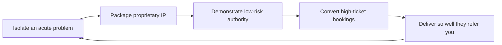
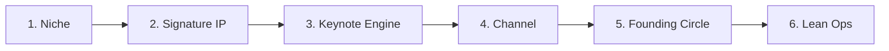
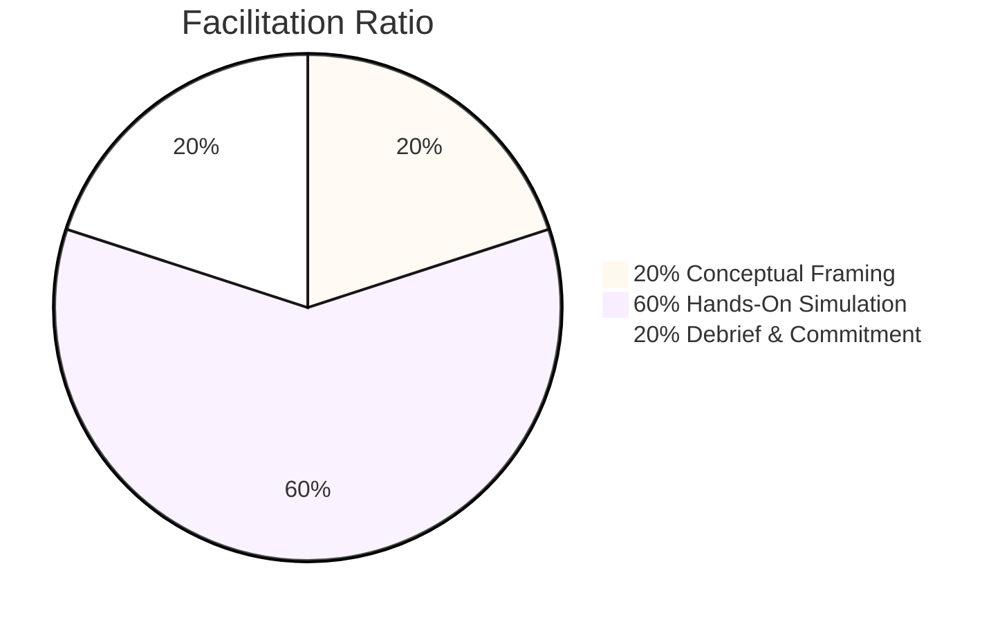
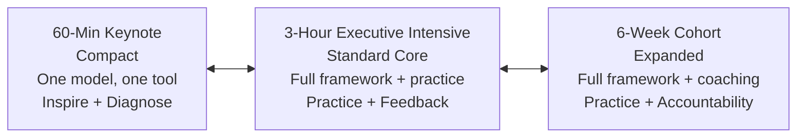
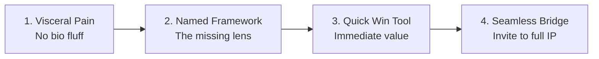
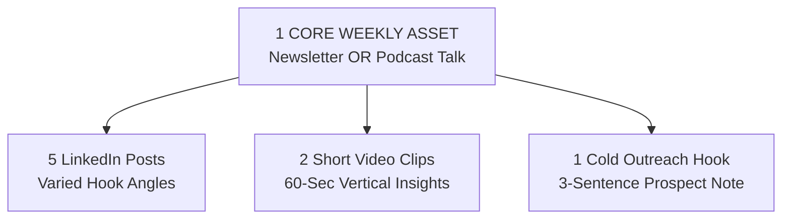
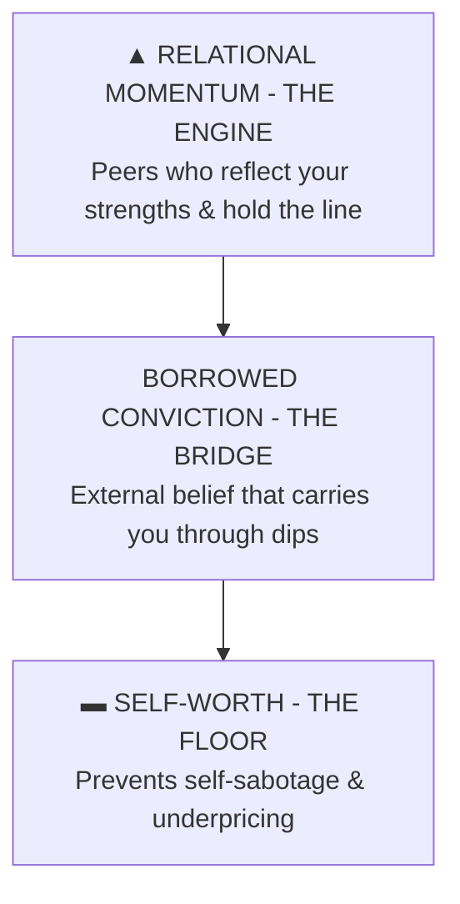
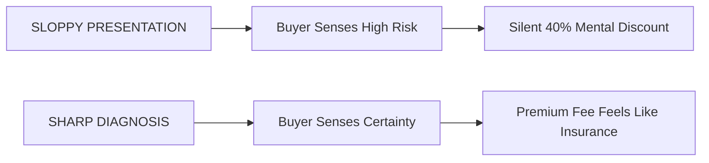
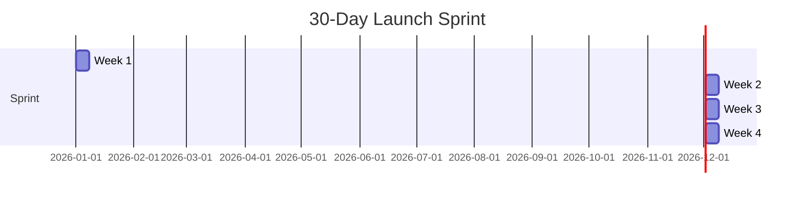

# The AI-Augmented Freelance Trainer
## The Complete Playbook for Paid Bookings, Premium Pricing, and Unshakeable Confidence

> **Most freelance trainers do not fail because they lack talent. They fail because they confuse motion with traction.**

---

## ⚡ At a Glance

| The Old Trap: Busywork | The Flywheel: Traction |
| :--- | :--- |
| Logo Design & Hex Codes | **1.** Isolate "Bleeding Neck" Pain |
| Complex LLC / Tax Structures | **2.** Build Signature IP |
| Posting on 4 Social Apps | **3.** Deliver Demo / Keynote |
| **Result: Zero Revenue** | **4.** Convert High-Ticket Bookings |

---

## Introduction

They spend months perfecting a logo, researching business structures, and posting on four platforms. It feels like building a business. It is actually sophisticated procrastination: busywork that keeps you safe from rejection and comfortably invisible.

A sustainable solo training practice does not require an agency's infrastructure. It requires a tight, repeatable flywheel:



Pair that flywheel with AI as a tireless chief of staff, and weeks of guesswork compress into afternoon sprints. AI does not replace your stories, judgment, or presence. It handles structure, pattern recognition, and rapid prototyping so you can show up sharper, faster, and more human.

This is the complete operating manual, from blank slate to five-figure engagements.

---

# Part I: The Roadmap to Paid Bookings



---

## 1. Isolate the "Bleeding Neck" Problem

Corporate Learning & Development leaders rarely have leftover budget for "nice-to-have" enrichment. They have urgent budget for fires they need to put out before the next quarterly review.

Early on, I pitched myself as a *"Communication Skills Trainer."* The response was polite nods and zero contracts. Everything shifted when I narrowed to a specific, costly bottleneck: *"Helping newly promoted engineering managers run high-stakes technical reviews without micromanaging their teams."*

When your niche is that sharp, two things happen: buyers immediately self-select, and your curriculum practically writes itself.

### A bleeding neck problem has three traits

1.  **Urgent:** It is costing money, time, or reputation right now.
2.  **Visible to leadership:** A VP can see it in a dashboard, attrition report, or missed deadline.
3.  **Expensive to ignore:** The cost of inaction is larger than your fee.

> **Test your niche with this sentence:** *"I help [specific buyer] solve [specific costly problem] so they get [measurable outcome] in [timeframe]."*
>
> If you cannot fill in every blank with precision, you are still too generic.

### Vitamin vs. Painkiller

| Positioning Dimension | Generic ("Vitamin") | Specific ("Painkiller") |
| :--- | :--- | :--- |
| **Title** | Leadership & Communication Coach | Technical Transition Specialist for Senior Engineers |
| **Core Promise** | "Improve team collaboration and morale" | "Cut code-review bottlenecks by 40% in 60 days" |
| **Buyer Reaction** | *"Send me your brochure; we'll keep you in mind."* | *"When are you free to talk to our VP of Engineering?"* |
| **Competition** | Everyone | Almost no one |
| **Price Anchor** | Compared to other trainers | Compared to cost of churn, delay, and rework |

**Where to find the pain:** Look for trigger events. A company that just raised a Series B, doubled headcount, launched a new product line, had a public outage, or posted five roles for team leads is not buying "leadership development." They are buying a solution to scaling pain.

> ### 🤖 THE AI ACCELERATOR: Voice-of-Customer Mining
> Scrape 15 to 20 raw posts from niche subreddits, Blind threads, or LinkedIn comment sections where your target audience vents. Feed them into an LLM to extract their exact vocabulary, the phrases they use at 11 PM when they are frustrated. Using their words in your outreach makes them feel like you have been reading their internal Slack channels. Do not invent the language. Borrow it, then mirror it back with precision.

---

## 2. Architect Your Signature Program

Once the problem is locked in, resist the urge to build ten different workshops. Build **one Signature Program**: a proprietary, repeatable methodology that takes a client from Point A (the acute pain) to Point B (the measurable outcome).

### The 20 / 60 / 20 Facilitation Ratio



| Slice | What It Is |
| :--- | :--- |
| **20%** | Tight Conceptual Framing (The Mental Model) |
| **60%** | Hands-On Simulation, Roleplay & Real Client Scenarios |
| **20%** | Structured Group Debrief & Action Commitment |

- **Name your framework:** Give your 3 to 5 step process a sticky, proprietary name (e.g., *The Clarity Loop* or *The 4-Gate Review*). Naming transforms "good advice" into intellectual property that only you can teach. A named framework is memorable, referable, and defensible. It also makes your proposal feel like a product, not hours.
- **Respect adult learning mechanics:** Professionals do not learn through passive lectures; they learn through friction and application. Follow the **20/60/20 rule**: 20% tight conceptual framing, 60% hands-on simulation and roleplay using their real workplace scenarios, and 20% structured debriefing and commitment.
- **Design for transfer, not applause:** A great workshop is not measured by smile sheets. It is measured by what changes on Monday morning. Every exercise should end with: What will you do differently, with whom, by when, and how will you know it worked?
- **Engineer it like an accordion:** Build your core modules so they expand or contract without losing structural integrity. The exact same IP should power a 60-minute keynote, a 3-hour executive intensive, and a 6-week cohort.

### The Accordion Model



### The Signature Program Blueprint

1.  **Diagnostic:** How you assess the team's current state before day one
2.  **Core Framework:** Your 3 to 5 step model, taught with stories and examples
3.  **Practice Lab:** Real scenarios from their world, with live coaching
4.  **Action Protocol:** Checklists, scripts, and decision tools they take back to work
5.  **Follow-up Loop:** A 30-day check-in that locks in behavior change and creates your next testimonial

> ### 🤖 THE AI ACCELERATOR: Curriculum & Scenario Engine
> Feed your core 4-step methodology into an LLM and ask it to generate minute-by-minute facilitator run-of-show guides, participant workbook prompts, and edge-case roleplay scenarios tailored to the client's industry. Translate the same conflict-resolution exercise for fintech versus healthcare versus manufacturing. AI is unmatched at structural scaffolding. You supply the point of view, the stories, and the final judgment on what is actually usable in a real room.

---

## 3. Weaponize Your Signature Presentation

Your **Signature Presentation** is not just a deliverable. It is your highest-converting sales asset. Whether delivered at an industry conference, a podcast interview, or a complimentary 45-minute corporate "lunch-and-learn," this talk must deliver a genuine breakthrough while making the audience realize they need your full program to sustain it.

### The Diagnosis-First Arc



- **Follow the Diagnosis-First Arc:** Open with a visceral, recognizable failure mode from their world. No biographical throat-clearing, no "I'm so excited to be here." Introduce your named framework as the missing mental model. Walk them through one immediately usable tool so they get a quick win in the room. Close with a frictionless bridge to working together: "If you want your team to run this live, with your real cases, that's what the full intensive is for."
- **Design slides as billboards, not teleprompters:** If your audience is reading a wall of bullet points, they are not listening to you. One idea per slide, bold typography, clean conceptual diagrams. Your slides should make sense in 3 seconds and be useless without you.
- **Capture a 3-minute sizzle reel:** Corporate buyers are risk-averse; they will not put you in front of their executives without seeing how you command a room. Record every talk, even small ones, and edit together 180 seconds of your sharpest stories, room energy, and audience reactions. One great reel is worth 50 cold emails.
- **Build the talk to be invited back:** End with a question the audience cannot answer alone. That unresolved tension is what creates inbound inquiries.

> ### 🤖 THE AI ACCELERATOR: Narrative Stress-Testing & Delivery Audit
> Before stepping on stage, paste your talk outline into an LLM and prompt it to act as a distracted audience member, flagging every spot where attention might drift. Afterward, drop the transcript of your recorded talk into AI to spot verbal crutches ("um," "sort of," "right?") and identify where your pacing rushed through key punchlines. Use AI to tighten the talk. Use humans to test whether it lands.

---

## 4. Pick One Energy-Aligned Marketing Engine

Consistency beats ubiquity. Trying to be everywhere guarantees you will burn out in six weeks. Choose **one primary distribution channel** that matches how you naturally think and communicate, and commit to it for 90 days:

- **If you think best on paper:** Publish one deeply practical, zero-fluff breakdown per week on LinkedIn or Substack dissecting a specific problem in your niche.
- **If you think best out loud:** Pitch yourself to 20 niche industry podcasts. Podcast hosts are constantly starving for articulate guests with fresh frameworks, and a 40-minute interview builds deeper trust than 100 tweets.
- **If you thrive in 1-on-1 conversations:** Run a direct, warm outreach campaign to former colleagues, managers, and L&D leads offering a no-pitch, 30-minute diagnostic workshop for their team.

The 90-day rule matters. Most trainers quit a channel at day 21, right before compounding starts. Give one channel a full quarter before you judge it.

### The Content Waterfall



**The weekly cadence that actually works:**

- **Monday:** Publish the core asset
- **Tuesday to Friday:** Repurpose one angle per day, respond to every comment, and send one warm outreach message
- **Friday:** Review what resonated, save the best language, feed it back into next week's asset

You do not need viral. You need 200 of the *right* people seeing you solve their exact problem, repeatedly.

> ### 🤖 THE AI ACCELERATOR: The Content Waterfall
> One core asset fuels your entire week. After you publish a 1,000-word newsletter or finish a podcast interview, feed the text or transcript into AI to fracture it into five distinct LinkedIn posts (each testing a different hook), two short-form video scripts, and a three-sentence outreach angle for prospects. You write once. AI repurposes. You edit with taste.

---

## 5. Build a "Founding Circle" Before Scaling

You do not need a massive email list to land your first five paid clients; you need ten evangelists who have experienced your work firsthand.

- **Launch a paid Beta Cohort:** Invite 6 to 10 ideal buyers into a pilot run of your Signature Program at 50% off your target rate. In exchange for the discount, require three things upfront: brutal feedback after every module, a specific case-study metric at the end, and a video testimonial if you deliver results. Paid beta is critical. Free participants do not show up, do not do the work, and do not give honest feedback.
- **Form a Peer Alliance:** Identify 3 to 5 non-competing consultants who serve your exact buyer (e.g., if you teach technical leadership, partner with an executive recruiter, a fractional CTO, and an agile coach). Meet monthly to trade market intelligence and warm introductions. One warm intro from a trusted peer is worth 100 cold emails.
- **Turn every delivery into an asset:** Every workshop should produce at least one testimonial, one case-study metric, one referral, and one piece of content. If it does not, you left value on the table.

> ### 🤖 THE AI ACCELERATOR: Feedback Synthesis & Warm Outreach
> After a beta cohort, dump all raw survey responses and chat logs into an LLM to cluster patterns, separating polite praise from the exact moments participants felt lost. For partner outreach, use AI to summarize a potential partner's recent podcast appearance or article so your introduction email proves you actually pay attention to their work.

---

## 6. Keep Operational Infrastructure Paper-Thin

Until you cross six figures, complex tech stacks are just expensive distractions. You need three things to look legitimate and close deals fast:

1.  **A high-converting one-sheet (PDF + simple landing page):** Clear headline stating who you help and the outcome, a visual breakdown of your Signature Program modules, three concrete learning outcomes, and two sharp testimonials. If a buyer cannot understand what you do in 10 seconds, your one-sheet is too clever.
2.  **A frictionless booking link:** Eliminate the 6-email scheduling dance. One link for discovery calls, one link for paid bookings.
3.  **A modular Statement of Work (SOW):** A clean two-page agreement outlining scope, deliverables, dates, and payment terms (always 50% upfront to reserve dates, 50% upon delivery) that you can customize and send within two hours of a discovery call. Speed is a trust signal. A proposal sent in two hours feels premium. A proposal sent in two weeks feels forgettable.

**What you do NOT need yet:** A fancy CRM, a course platform, a logo suite, an LLC debate, or a 12-page website. Those are Phase 2 problems.

---

# Part II: The Mindset — You Can't Gaslight Yourself Into Confidence

Somewhere between building my curriculum and pitching my first $10,000 corporate engagement, I hit a wall that no productivity hack could fix.

Modern solopreneur advice pushes a quiet lie: that confidence is an internal battery you charge alone in a room through morning affirmations, cold plunges, and sheer willpower.

It does not work. Humans are wired for social calibration, and **confidence is not generated in isolation, it is reflected, borrowed, and stress-tested in community.** When you are staring at three unanswered proposals and questioning whether you belong in the room, trying to "manifest" belief feels like trying to lift yourself off the floor by pulling on your own shoelaces.

### The Architecture of Resilience



| Layer | Role | What It Does |
| :--- | :--- | :--- |
| **▲ Relational Momentum** | THE ENGINE | Peers who reflect your strengths & hold the line |
| **Borrowed Conviction** | THE BRIDGE | External belief that carries you through dips |
| **▬ Self-Worth** | THE FLOOR | Prevents self-sabotage & underpricing |

### Why a Circle of Believers Outperforms Solo Grit

**1. Borrowed conviction bridges the valley of death**
Every independent trainer hits seasons where self-doubt spikes, usually right after a tough room, a lost bid, or a bold price increase. During those dips, you do not need self-help quotes; you need a peer who has seen your work look you in the eye and say, *"I've watched you facilitate. You're underselling this by half."* You borrow their certainty until yours grows back.

**2. Accurate mirrors correct negativity bias**
Left alone in your own head, your brain acts like a funhouse mirror, magnifying every awkward pause in a workshop while erasing the three executives who asked for your card afterward. Trusted peers act as objective historians, holding up receipts of your actual competence when imposter syndrome tries to rewrite your track record.

**3. Shared visibility turns paralysis into momentum**
Working solo makes it dangerously easy to hide behind "research" and "tweaking slides." When two or three fellow builders know what you committed to shipping by Friday, reluctance turns into execution. Accountability does not just make the work lighter; it makes finishing feel inevitable.

**4. Normalization kills shame**
Solo trainers think everyone else is closing deals effortlessly. In a real peer circle, you learn that everyone gets ghosted, everyone has a bad room, everyone fears raising prices. That normalization is not comforting fluff. It is data that keeps you from quitting on a normal bad week.

> ### 🤖 THE AI ACCELERATOR: The Cognitive De-Escalator
> AI can never replace human empathy, so I do not ask it for pep talks. Instead, I use it as an emotional filter before I call a mentor. When I am spiraling over a rejection, I brain-dump my messy, irrational fears into an LLM and ask it to separate *objective facts* from *catastrophic assumptions*. It clears the static so I can bring a sharp, grounded question to my human circle rather than raw panic. AI cleans the signal. Humans supply the belief.

### The Nuance Nobody Mentions

Self-worth still matters, but it functions as a **floor, not an engine.** High self-worth stops you from accepting disrespectful clients, tolerating scope creep, or slashing your rates out of desperation. It prevents self-sabotage.

What actually propels you across the finish line into rooms you have never been in before is **relational momentum**, being surrounded by people who refuse to let you shrink when things get uncomfortable.

Build your circle intentionally:

- **1 Mentor:** Someone 2 to 3 steps ahead who has sold what you want to sell
- **2 to 3 Peers:** Fellow trainers or consultants at your level, meeting weekly or biweekly
- **1 Truth-teller:** Someone who will tell you when your talk is flat or your price is too low, without softening it

### A 60-Second Reality Check

Whenever you feel stalled on a big leap, ask yourself:

- *Who in my life knows the unedited reality of what I am trying to build right now?*
- *Who has witnessed my best work and would remind me of it in thirty seconds if I asked?*
- *Am I waiting to "feel ready" before reaching out, when reaching out is the exact thing that creates readiness?*

If you cannot answer the first two questions, your next business task is not a new funnel. It is finding your people.

---

# Part III: The Business — Your Price Is Set Before You Say a Number

Early in my practice, I treated pricing like a math problem: estimate the prep hours, add the delivery hours, multiply by a respectable hourly rate, and hope the client did not flinch.

Then I lost a bid to a consultant charging three times my quote, for half the workshop days.

That loss taught me a fundamental law of B2B services: **buyers do not purchase effort; they purchase certainty.** And their perception of your certainty is locked in long before you ever mention a dollar figure. Nobody emails you to say, *"Your discovery call felt unfocused and your proposal had formatting inconsistencies, so I mentally discounted your value by 40%."* They simply say, *"We decided to go in another direction,"* or vanish into silence.



### The Invisible Risk Tax

When a VP of L&D looks at your proposal, they are not calculating your hourly wage. They are running a silent risk assessment: *If I put my reputation on the line to bring this person in front of 40 senior leaders, what are the odds I look like a hero versus the odds I have to clean up a mess?*

- **Precision signals safety:** Prompt follow-ups, sharp diagnostic questions, zero jargon, and crystal-clear deliverables make a $12,000 fee feel like insurance against failure.
- **Friction signals risk:** Vague outcomes, rambling explanations, or hesitant language make a $1,500 fee feel like a gamble.

**When you under-present, you under-price.** The discount never appears as a line item on your invoice, it gets deducted silently inside the buyer's mind.

### Three Levers That Command Premium Fees

#### 1. Diagnose Before You Prescribe

Vendors lead with their catalog (*"Here are the 12 workshops I offer"*). Strategic partners lead with a diagnosis so sharp the buyer feels relieved just hearing it articulated. When you accurately name the downstream cost of their team's current bottleneck, missed deadlines, engineering churn, stalled initiatives, your fee stops being compared to a training budget and starts being compared to the cost of inaction.

Use this discovery formula: **Symptom > Cost > Cause > Consequence > Commitment.**
Ask: What is happening? What is it costing you? Why do you think it keeps happening? What happens if it continues for another quarter? What would solving it be worth?

> ### 🤖 THE AI ACCELERATOR: Pre-Call Intelligence Briefing
> Thirty minutes before any discovery call, feed the company's annual report, recent press releases, job postings (which reveal what skills they are struggling to hire for), and the buyer's LinkedIn profile into AI. Ask it to generate three sharp hypotheses about internal friction points. Asking *"I noticed you're scaling your backend team by 30% this quarter, how are your senior ICs handling the sudden jump in code-review load?"* immediately separates you from 99% of trainers.

#### 2. Eliminate Every Millimeter of Ambiguity

Confusion kills deals faster than high prices. If a buyer has to squint to understand who attends, what pre-work is required, how success is measured, or what happens after the session, they stall. Ambiguity creates internal friction when your champion tries to get budget approval from finance.

Your proposal should answer, in one page: Who is this for, what problem does it solve, what exactly happens, what do they walk away with, how will we measure success, and what is the investment.

> ### 🤖 THE AI ACCELERATOR: The Friction Audit
> Before sending any proposal, run it through an LLM with explicit instructions to highlight every vague phrase (*"ongoing support," "tailored modules," "improved alignment"*) and force you to replace it with concrete, observable deliverables. If AI cannot picture what you mean, neither can your buyer.

#### 3. State Your Fee Like a Weather Report

Apologetic phrasing destroys authority in half a second. Compare these two deliveries:

> ❌ **The Self-Discount:** *"For a two-day offsite like this, I usually charge around $8,500, though I know budgets are tight right now so we can definitely play around with the numbers if that feels steep."* (You just signaled that your price is arbitrary and you do not fully believe in it.)

> ✅ **The Anchor:** *"The investment for the full two-day Leadership Intensive, including the pre-workshop team diagnostic, custom simulations, and the 30-day manager follow-up lab, is $8,500."* (Stop talking. Hold eye contact or stay silent on the line.)

Silence after stating a price is not awkward; it is the sound of a buyer doing the math and respecting your composure.

**Pricing architecture that works:**

- **Single-day workshop:** Entry point, but never your only offer
- **Intensive + Follow-up:** Your core, premium offer. The follow-up is what creates lasting change and justifies the fee
- **Cohort / Retainer:** Recurring revenue, deeper transformation, and the easiest upsell because trust is already built

Never discount the fee. If you must flex, flex the scope, not the price. Remove the follow-up lab, shorten the cohort, or reduce headcount, but keep your rate intact. Discounting trains buyers to negotiate. Scoping trains them to respect your structure.

### The 5-Point Packaging Audit

Before you ever lower a rate, run your sales process through these five filters:

| Audit Checkpoint | Low-Trust Signal (Commodity) | High-Trust Signal (Partner) |
| :--- | :--- | :--- |
| **1. The Opening** | Starts with your bio, credentials, and logo | Starts with *their* acute problem and desired state |
| **2. Discovery Call** | Asks basic questions found on their website | Brings hypotheses based on hiring & market signals |
| **3. The Framing** | *"Cost for 1 day of facilitation"* | *"Investment in the 90-Day Technical Lead Accelerator"* |
| **4. Verbal Leaks** | Uses *"just," "roughly," "try to," "if that's okay"* | Direct, declarative statements without hedges |
| **5. The Mirror Test** | Dense text walls with vague outcomes | Scannable deliverables, clear timeline, defined ROI |

> ### 🤖 THE AI ACCELERATOR: The Red-Team Buyer Simulation
> Paste your finished proposal into an LLM and tell it to roleplay a cynical CFO or time-starved VP of HR looking for reasons to say no. Fixing the three objections it surfaces before the client sees the document routinely saves deals.

### The Non-Negotiable Caveat

Sharp packaging elevates your ceiling, but **delivery determines whether you stay there.** High-gloss marketing wrapped around mediocre facilitation is just an accelerated path to burning your reputation. The sequence is absolute: **build real mastery first, then make that mastery legible.** Most independent trainers are not under-skilled, they are simply under-translated.

**Stop lowering your price. Start raising your clarity.**

---

# Part IV: The AI Operating System — My Master Prompt Library

I do not use AI to replace my expertise, stories, or facilitation instincts. I treat it like a **sharp, hyper-literate chief of staff**: I supply the strategy, raw insights, and final judgment; it handles structural heavy lifting, pattern recognition, and rapid prototyping.

Copy, customize, and save these prompts as reusable templates across every stage of your practice. For each one, paste your real context in brackets. The more specific your input, the less generic the output.

---

## Phase 1: Niche & Market Intelligence

### Prompt 1: The "Bleeding Neck" Language Extractor

```text
Act as a qualitative market researcher. Below are [10-15 raw posts/comments] from [target audience, e.g., newly promoted nursing managers / Series B SaaS sales directors]. Analyze this text and extract:
1. The top 3 recurring operational frustrations they face.
2. The exact emotional phrases, metaphors, and slang they use when complaining about these issues.
3. What they have already tried that failed.
Present the output in a clean table so I can use their exact language in my workshop marketing.
```

### Prompt 2: The Positioning Sharpener

```text
I am an independent corporate trainer positioning myself as: '[Insert current positioning statement]'. Critique this from the perspective of a busy VP of Learning & Development. Tell me:
1. Why this sounds too generic or 'nice-to-have.'
2. Three ways to narrow the target buyer and tie the training to a measurable business KPI (e.g., retention, cycle time, revenue, error reduction).
3. Five punchy, outcomes-focused headlines I could test on my LinkedIn profile.
```

### Prompt 2B: The Competitor Gap Finder (New)

```text
Here are 3 competitor trainer websites / LinkedIn bios in my niche: [Paste links or text]. Analyze what they all promise, what language they all use, and where they all sound identical. Then identify 3 positioning gaps they are ignoring that I could own, based on my background in [Insert your edge].
```

---

## Phase 2: Signature Curriculum Design

### Prompt 3: The Active-Learning Workshop Architect

```text
I am designing a [3-hour / full-day] interactive workshop on [Topic] for [Target Audience]. My proprietary framework has [3/4] steps: [Step 1], [Step 2], [Step 3]. Build a minute-by-minute facilitator agenda following a 20% concept / 60% hands-on practice / 20% debrief split. For every module, design a realistic, high-friction exercise or roleplay, no generic 'turn to your neighbor and discuss' prompts. Include exact facilitator debrief questions for each activity.
```

### Prompt 4: The Industry-Specific Scenario Generator

```text
Write three realistic, high-stakes workplace scenarios for a training exercise on [Skill, e.g., pushing back on unrealistic stakeholder deadlines]. The participants are [Target Role] at a [Industry/Company Stage]. For each scenario, provide:
- Context: A 3-sentence background setup.
- The Trigger: The exact email or Slack message that sparks the conflict.
- Hidden Constraints: One political or operational constraint the participant must navigate without ruining the relationship.
```

### Prompt 5: The Accordion Content Adapter

```text
Here is the full outline of my [4-hour] Signature Workshop: [Paste outline]. Condense this into a high-impact, 45-minute keynote or 'lunch-and-learn' talk. Keep only the single sharpest conceptual model and one 5-minute interactive audience exercise. Structure it with a gripping 2-minute opening hook and a natural closing transition that invites attendees to inquire about bringing the full workshop to their team.
```

### Prompt 5B: The Workbook & Takeaway Builder (New)

```text
Based on this workshop outline: [Paste outline], create a 1-page participant takeaway sheet. Include: 1) The framework visual described in words, 2) Three fill-in-the-blank scripts they can use on Monday, 3) A 7-day action checklist with one small behavior per day.
```

---

## Phase 3: Energy-Aligned Marketing & Outreach

### Prompt 6: The Content Waterfall Engine

```text
Below is a raw transcript of me talking for 5 minutes about [Topic] / an article I wrote: [Paste text]. Transform this single core insight into:
1. Two LinkedIn posts: One contrarian/myth-busting hook, and one tactical 'how-to' breakdown (under 220 words each, short paragraphs, zero corporate buzzwords).
2. One 60-second vertical video script: Structured as Hook (0-5s), Core Insight + Example (5-45s), Actionable Takeaway (45-60s).
3. One 3-sentence cold outreach angle I can send to [Target Buyer Title] referencing this exact insight.
```

### Prompt 7: The Zero-Fluff "Lunch-and-Learn" Pitch

```text
Draft a cold outreach email (strictly under 120 words) to [Name], [Title] at [Company]. Context: I noticed [specific company trigger, e.g., they just closed a Series B / posted 5 roles for Team Leads / their CEO spoke on Podcast X about scaling culture]. Offer a complimentary, zero-pitch 30-minute interactive micro-workshop for their [Target Team] on solving [Specific Pain Point]. Keep the tone peer-to-peer, direct, and low-pressure, no exclamation points or 'hope this email finds you well.'
```

### Prompt 7B: The Podcast Pitch Engine (New)

```text
Draft a 150-word podcast pitch to [Host Name] of [Podcast Name]. My angle is [Insert contrarian take]. Include: Why their audience cares right now, 3 specific questions I can answer better than a generic guest, and one story I can tell that proves I have lived this. Tone: confident, specific, easy to say yes to.
```

---

## Phase 4: High-Trust Sales & Packaging

### Prompt 8: The Pre-Call Diagnostic Brief

```text
I have a discovery call tomorrow with [Name], [Title] at [Company]. Based on the company info and recent news pasted below [paste About page / recent news / job descriptions]:
1. Identify 3 likely internal growing pains their team is experiencing right now.
2. Give me 5 sharp, diagnostic questions I can ask on the call that demonstrate deep industry understanding and uncover the financial or operational cost of those pains.
3. List the top 2 objections they might raise about bringing in an external trainer, and how I should reframe each.
```

### Prompt 9: The Cynical Buyer Proposal Audit

```text
Act as a skeptical, budget-conscious VP of People who receives ten training pitches a week. Review my draft proposal below: [Paste proposal]. Be ruthless:
1. Highlight every sentence that sounds vague, academic, or 'fluffy.'
2. Identify where the ROI or business impact feels weak.
3. List the top 3 reasons you would stall or ask for a 30% discount, and suggest specific edits to eliminate each risk signal.
```

### Prompt 9B: The Follow-Up That Does Not Beg (New)

```text
I sent this proposal 5 days ago and have not heard back: [Paste proposal summary]. Draft 3 follow-up messages: 1) A 2-sentence value-add nudge with a relevant article or insight, 2) A polite close-the-loop email that gives them an easy out, 3) A final breakup email that leaves the door open. Tone: calm, professional, zero desperation.
```

---

## Phase 5: Lean Operations & Iteration

### Prompt 10: The Rapid Statement of Work (SOW) Builder

```text
Turn these raw discovery call notes into a clean, formal 1-page Statement of Work (SOW): [Paste bullet points: client name, workshop title, format, dates, headcount, custom prep included, fee, and 50/50 payment schedule]. Organize it with clear headings: Project Objective, Scope of Deliverables, Client Responsibilities (e.g., room setup, participant roster), Timeline, and Investment & Terms. Keep the legal tone clean, plain-English, and professional.
```

### Prompt 11: The Beta Cohort Pattern Decoder

```text
Analyze these raw post-workshop survey responses from my pilot cohort: [Paste feedback]. Give me:
1. The top 3 highest-leverage moments (what created the biggest 'aha' shifts).
2. The exact friction points where pacing dragged or instructions felt unclear.
3. Three concrete edits I should make to my slides or exercises before running this for a full-fee corporate client.
```

### Prompt 11B: The Testimonial Extractor (New)

```text
From these raw client quotes and survey responses: [Paste text], extract the 3 strongest testimonials I can use publicly. For each, rewrite it into a tight 2-sentence version that leads with the outcome, not the praise. Preserve their exact words for the outcome metric. Suggest where to use each: website, one-sheet, or LinkedIn.
```

---

## 🧠 My 3 Guardrails for AI-Augmented Trainers

### The Human-AI Division of Labor

| AI OWNS (Structure & Speed) | YOU OWN (Soul & Judgment) |
| :--- | :--- |
| Raw pattern clustering | Lived stories & scars |
| Agenda timing & scaffolding | Contrarian points of view |
| Proposal friction audits | Live room reading & presence |
| Content format repurposing | Final editorial taste |

1.  **Never outsource your point of view:** If you ask AI to *"write a workshop on leadership,"* it will hand you sanitized, Wikipedia-level clichés that any participant could generate themselves in ten seconds. Feed AI **your** frameworks, **your** contrarian opinions, and **your** messy real-world stories first, then let it organize and expand them.
2.  **Hunt and destroy "AI tells":** Before anything reaches a client or LinkedIn feed, strip out robotic transitions and overused LLM filler (*"delve," "tapestry," "testament to," "in today's fast-paced landscape," "unlock your potential"*). If you would not say a sentence out loud over coffee with a peer, cut it.
3.  **Keep the human moments sacred:** AI builds the architecture, sharpens the pitch, and clears the admin queue so that when you step into the room, or onto the call, you are 100% present, unhurried, and deeply human. That presence is the one thing no algorithm can ever commoditize.

---

## Your 30-Day Launch Sprint

If you are starting from zero, do not try to do everything. Do this:



- **Week 1: Clarity** — Pick your bleeding neck problem. Interview 5 ideal buyers. Extract their language with Prompt 1.
- **Week 2: Build** — Name your framework. Build the accordion version: keynote, intensive, cohort. Use Prompts 3, 4, and 5.
- **Week 3: Prove** — Run one free lunch-and-learn or podcast. Record it. Cut your sizzle reel. Use Prompts 6 and 7.
- **Week 4: Sell** — Pitch your paid beta cohort to 10 warm contacts. Send 10 outreach emails. Use Prompts 8, 9, and 10.

> **One niche. One framework. One channel. One circle. One price you state without flinching.**
>
> **That is the whole business.**
